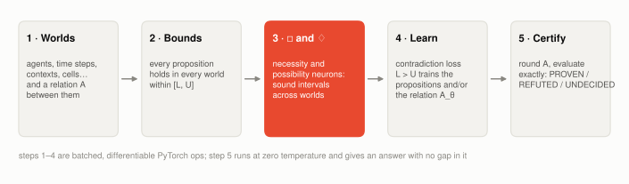
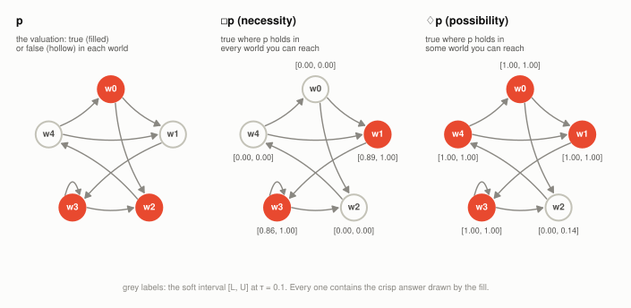
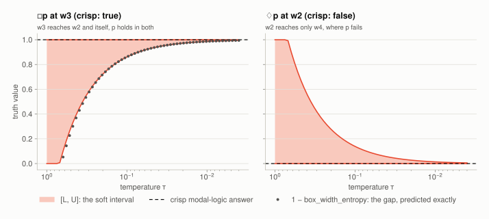
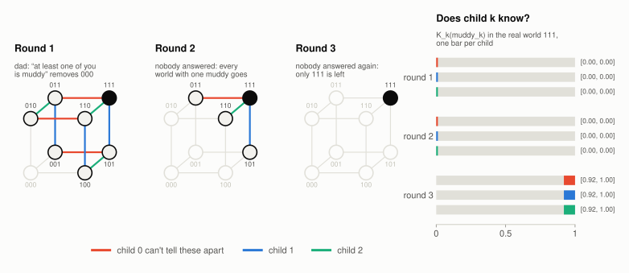
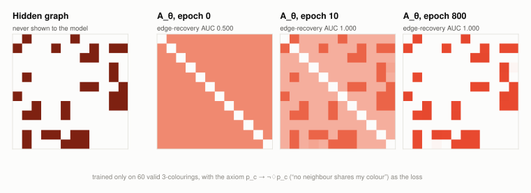
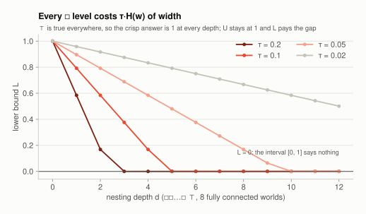
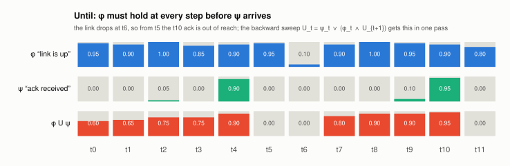
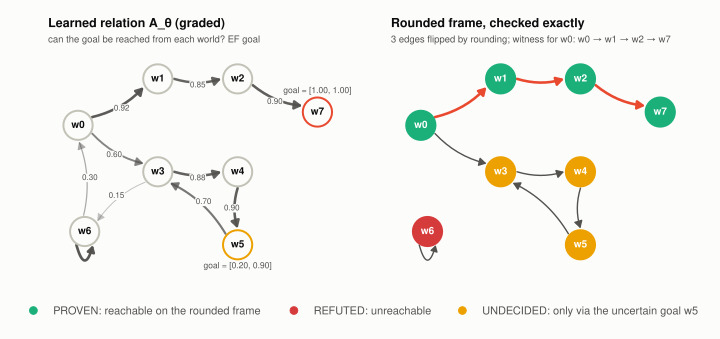

# torchmodal in pictures

A beginner's walkthrough. You don't need to know modal logic, only a little PyTorch. Every
picture below is computed by the library itself ([`docs/make_figures.py`](make_figures.py)),
and every code snippet runs as written. Snippets build on the setup in section 1.

**Contents:** [the big picture](#0-the-big-picture) ·
[worlds, arrows, □ and ♢](#1-worlds-arrows-and) ·
[intervals, not guesses](#2-intervals-not-guesses) ·
[reasoning about what others know](#3-reasoning-about-what-others-know) ·
[learning the arrows](#4-learning-the-arrows) ·
[the price of nesting](#5-the-price-of-nesting) ·
[time: until](#6-time-until) ·
[from a learned relation to a proof](#7-from-a-learned-relation-to-a-proof) ·
[glossary](#glossary)

---

## 0. The big picture

<picture>
  <source media="(prefers-color-scheme: dark)" srcset="figures/pipeline-dark.svg">
  
</picture>

Ordinary logic asks *is this true?* Modal logic asks *is this true **everywhere I can reach**?*
or *is it true **somewhere I can reach**?* The "places" are **worlds**: agents, moments in time,
cells of a puzzle, contexts. An **accessibility relation** says which worlds can see which.

torchmodal turns those two questions into neural-network layers. Each answer is an interval
`[L, U]` that is guaranteed to contain the textbook answer, the relation between worlds can be
**learned** by gradient descent, and once training is done the result can be **checked
exactly**.

## 1. Worlds, arrows, □ and ♢

<picture>
  <source media="(prefers-color-scheme: dark)" srcset="figures/kripke-dark.svg">
  
</picture>

Five worlds, some arrows between them, and a fact `p` that is true in some worlds (filled) and
false in others (hollow). Two questions, asked in every world at once:

- **□p, "necessarily p":** is `p` true in *every* world this one points to? `w1` points only to `w3`, where `p` holds, so yes. `w0` points to `w1`, where `p` fails, so no.
- **♢p, "possibly p":** is `p` true in *at least one* world this one points to? Only `w2` fails: its single arrow goes to `w4`.

A world, its arrows, and its facts together form a **Kripke model**. In torchmodal it is just
two tensors: a `(|W|, |W|)` relation and one `[L, U]` row per world.

```python
import torch
from torchmodal import functional as F

A = torch.zeros(5, 5)                                     # A[i, j] = 1: world i sees world j
for i, j in [(0, 1), (0, 2), (1, 3), (2, 4), (3, 2), (3, 3), (4, 0), (4, 1)]:
    A[i, j] = 1.0
p = torch.tensor([1., 0., 1., 1., 0.]).unsqueeze(-1).expand(-1, 2)   # [L, U] per world

F.necessity(p, A, tau=0.1)          # □p, shape (5, 2); row 3 is [0.86, 1.00]
F.possibility(p, A, tau=0.1)        # ♢p; row 2 is [0.00, 0.14]
F.necessity(p, A, mode="exact")     # τ = 0: crisp 0 / 1, no gap, no gradient
```

Both operators accept a leading batch dimension and are differentiable in the facts **and**
in `A`. That second part is what makes section 4 possible.

## 2. Intervals, not guesses

<picture>
  <source media="(prefers-color-scheme: dark)" srcset="figures/tau-dark.svg">
  
</picture>

"Every" is a `min` and "some" is a `max`, and neither has a useful gradient. torchmodal
replaces them with smooth versions controlled by a **temperature τ**. The price is a little
imprecision, and the library is honest about it: instead of one number it returns an interval
`[L, U]` that **always contains the crisp answer** (the dashed line). As τ shrinks the interval
closes in. At τ = 0 (`mode="exact"`) it is the crisp answer.

The width of that interval isn't a rough estimate either. It is computable exactly, and the dots
above, drawn from `box_width_entropy`, sit right on the edge. Because it is exact, you can
run it backwards: say how much imprecision you will accept and let the library pick τ.

```python
F.box_width_entropy(A, p, tau=0.1)       # exact width per world; w3 → 0.14
F.necessity(p, A, precision=0.05)        # ask for a width instead of a τ; row 3 → [0.96, 1.00]
F.auto_tau(A, target_width=0.05)         # or just get the τ: 0.031
```

## 3. Reasoning about what others know

<picture>
  <source media="(prefers-color-scheme: dark)" srcset="figures/muddy-dark.svg">
  
</picture>

Three children all have mud on their foreheads. Each sees the others but not themselves. Their
father says "at least one of you is muddy", then keeps asking whether anyone knows. Nobody does
after the first question, or the second. After the third, all three do.

Each corner of the cube is a possible world: `101` means children 0 and 2 are muddy. A
coloured edge joins two worlds that one child **can't tell apart**, because they differ only
on that child's own forehead. "Child 0 knows it is muddy" is exactly □ over child 0's edges.
Each unanswered question removes worlds. Once `111` is the only world left, every child's □
is true.

```python
from itertools import product

worlds = list(product([0, 1], repeat=3))                  # 000 … 111
here = worlds.index((1, 1, 1))
same_but_me = torch.tensor([[float(w[1:] == v[1:]) for v in worlds] for w in worlds])
muddy = torch.tensor([[float(w[0])] * 2 for w in worlds])

for rnd in range(3):
    alive = torch.tensor([float(sum(w) > rnd) for w in worlds])   # who is still possible
    print(rnd + 1, F.necessity(muddy, same_but_me * alive, tau=0.05)[here])
# 1 tensor([0., 0.])   2 tensor([0., 0.])   3 tensor([0.92, 1.00])
```

The full version, [`examples/muddy_children.py`](../examples/muddy_children.py), checks all
three children and asserts that every interval contains the textbook answer.
`torchmodal.epistemic` has the group operators: everybody knows (`E_G`), distributed knowledge
(`D_G`) and common knowledge (`C_G`).

## 4. Learning the arrows

<picture>
  <source media="(prefers-color-scheme: dark)" srcset="figures/learn-dark.svg">
  
</picture>

So far the arrows were given. In most real problems they aren't. Who trusts whom? Which
event can cause which? Which nodes of a graph constrain each other? torchmodal can **learn
the relation** `A_θ` from data.

Here a graph is hidden. The model only sees 60 valid 3-colourings of it, and one rule:

> p_c → ¬♢p_c   *if I have colour c, nobody I can see has colour c.*

Two nodes that never share a colour can safely be connected. Two that sometimes do can't be.
Gradient descent on the rule alone recovers all 17 hidden edges, and nothing else.
No edge, and no negative example, was ever shown.

```python
n = 12
g = torch.Generator().manual_seed(0)
planted = torch.randint(0, 3, (n,), generator=g)                   # a secret 3-colouring
hidden = torch.triu((torch.rand(n, n, generator=g) < 0.2) & (planted[:, None] != planted), 1)
hidden = (hidden | hidden.T).float()                               # the graph to recover

every = torch.cartesian_prod(*[torch.arange(3)] * n)               # all 3^12 colourings
clash = ((every[:, :, None] == every[:, None, :]) & hidden.bool()).any(-1).any(-1)
valid = every[~clash][torch.randperm(int((~clash).sum()), generator=g)[:60]]
P = torch.eye(3)[valid].transpose(1, 2).reshape(-1, n)             # (180, 12): "node has colour c"

logits = torch.nn.Parameter(torch.zeros(n, n))                     # A_θ, all 0.5 to start
opt = torch.optim.Adam([logits], lr=0.05)
for step in range(800):
    A = torch.sigmoid(logits)
    A = 0.5 * (A + A.T) * (1 - torch.eye(n))                       # symmetric, no self-loops
    dia = F.possibility(P, A.expand(len(P), n, n), tau=0.1)        # ♢p_c in every world
    violation = (1 - F.implication(P, F.negation(dia))).sum() / len(valid)
    loss = violation - 2.0 * A.mean()                             # obey the rule, else add edges
    opt.zero_grad(); loss.backward(); opt.step()

print(((A > 0.5).float() == hidden).all())                         # tensor(True): every edge recovered
```

Notebook [`03_graph_coloring.ipynb`](../examples/notebooks/03_graph_coloring.ipynb) walks through
the same experiment step by step. For bigger frames,
`nn.MetricAccessibility` (embeddings, O(|W|·d)) and `nn.AttentionAccessibility` (from per-world
features) replace the direct matrix. `torchmodal.SparsityLoss` and `AxiomRegularization`
(reflexive, transitive, symmetric…) shape what gets learned.

## 5. The price of nesting

<picture>
  <source media="(prefers-color-scheme: dark)" srcset="figures/depth-dark.svg">
  
</picture>

Each □ adds its own slice of imprecision, and **nested** operators add them up. "Agent a
knows that agent b knows that…" is three levels deep. In the picture the formula is always
true, yet after enough levels the lower bound reaches 0 and the interval `[0, 1]` no longer
says anything. On 8 fully connected worlds at τ = 0.1 that happens at depth 5.

```python
A8 = torch.ones(8, 8)
b = torch.ones(8, 2)                                      # ⊤: true everywhere
for depth in range(1, 6):
    b = F.necessity(b, A8, tau=0.1)
    print(depth, b[0])                                    # L: 0.79, 0.58, 0.38, 0.17, 0.00
```

Section 2 already has the remedy: `box_width_entropy` says what each level costs, and
`precision=` or a smaller τ buys depth back. If a term stops training,
`torchmodal.diagnostics.gradient_health` names the one that has gone flat.

## 6. Time: until

<picture>
  <source media="(prefers-color-scheme: dark)" srcset="figures/until-dark.svg">
  
</picture>

Make the worlds moments in time and the arrows point forward, and □ becomes **always**
(`G`) while ♢ becomes **eventually** (`F`). The **until** operator `φ U ψ` asks for more: φ
must hold at **every** step **before** ψ arrives.

Here the link (φ) must stay up until an acknowledgement (ψ) arrives. Before the t4 ack it
does, so `φ U ψ` is high. At t6 the link drops, which cuts t5 and t6 off from the next ack at
t10. The values before t4 shrink a little at each step back, because every step adds a little
doubt about whether the link really was up.

```python
phi = torch.tensor([.95, .9, 1., .85, .9, .95, .1, .9, 1., .95, .9, .8])    # link is up
psi = torch.tensor([0., 0., .05, 0., .9, 0., 0., 0., 0., .1, .95, 0.])      # ack received
two = lambda x: x.unsqueeze(-1).expand(-1, 2)                               # point → [L, U]

F.until(two(phi), two(psi), torch.triu(torch.ones(12, 12)))[:, 0]
# tensor([0.60, 0.65, 0.75, 0.75, 0.90, 0.00, 0.00, 0.80, 0.90, 0.90, 0.95, 0.00])
```

`F.until` assumes a straight timeline. For branching or learned time, use `F.until_graph`, and
`torchmodal.fixpoint` has the full CTL set (`EX AX EF EG AF AG EU AU`).

## 7. From a learned relation to a proof

<picture>
  <source media="(prefers-color-scheme: dark)" srcset="figures/certify-dark.svg">
  
</picture>

A learned relation is graded: an arrow with weight 0.6 is neither there nor absent, so no
classical statement about it can be checked. `verify.round_and_certify` makes it checkable.
It rounds the relation to a real graph, evaluates the property **exactly** (no temperature,
no gap), and reports one verdict per world:

- **PROVEN**, with a **witness**: the actual path, here `w0 → w1 → w2 → w7`.
- **REFUTED**: `w6` can't reach any goal.
- **UNDECIDED**: `w3`, `w4` and `w5` can reach only `w5`, which might or might not be a goal (`[0.20, 0.90]`). The library says so instead of guessing.

```python
from torchmodal import verify

A = torch.zeros(8, 8)
for i, j, w in [(0, 1, .92), (1, 2, .85), (2, 7, .90), (0, 3, .60), (3, 4, .88),
                (4, 5, .90), (6, 6, .95), (5, 3, .70), (3, 6, .15), (6, 0, .30)]:
    A[i, j] = w
goal = torch.tensor([[0, 0], [0, 0], [0, 0], [0, 0], [0, 0], [.2, .9], [0, 0], [1, 1.]])

r = verify.round_and_certify(goal, A, operator="ef")     # EF goal: "a goal is reachable"
r.verdicts        # ['PROVEN', 'PROVEN', 'PROVEN', 'UNDECIDED', 'UNDECIDED', 'UNDECIDED', 'REFUTED', 'PROVEN']
r.witnesses[0]    # [0, 1, 2, 7]
r.n_flipped       # 3: how far rounding moved the relation
```

The certificate is about the **rounded** graph, and `r.relation` and `r.n_flipped` are there so
you can report that honestly. `verify.to_smv` exports the same graph to the nuXmv / NuSMV
model checkers.

---

## Glossary

| Term | Meaning |
|---|---|
| **world** | one situation the model reasons about: an agent's viewpoint, a time step, a cell |
| **accessibility** `A` | which worlds each world can "see"; fixed (`R`) or learned (`A_θ`), values in [0, 1] |
| **Kripke model** | worlds + accessibility + which facts hold where |
| **□ (necessity)** | true in *every* accessible world. Also *knows* (K), *believes* (B), *always* (G) |
| **♢ (possibility)** | true in *some* accessible world. Also *eventually* (F); dual of □: ♢φ = ¬□¬φ |
| **[L, U]** | lower and upper bound on a truth value; the crisp answer is always inside |
| **τ (temperature)** | how smooth the operators are; smaller = tighter intervals, sharper gradients |
| **contradiction** | `L > U`: no truth value fits. Its size is the training loss `L_contra` |
| **vacuous** | `[0, 1]`: the bound says nothing |
| **certificate** | an exact verdict (PROVEN / REFUTED / UNDECIDED) on the rounded relation |

Want the details? The [README](../README.md) lists every operator and its guarantee, and
[limitations](limitations.md) lists the traps, with numbers.
